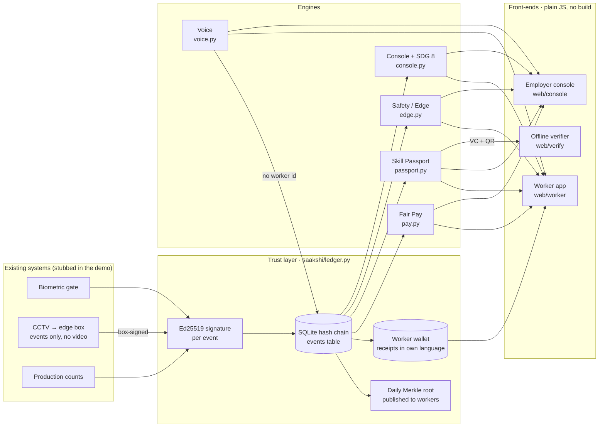
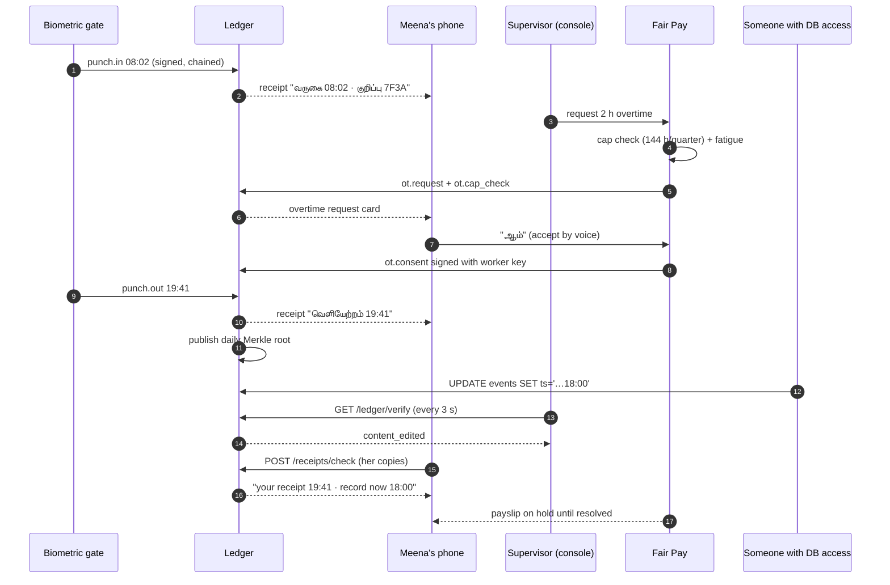
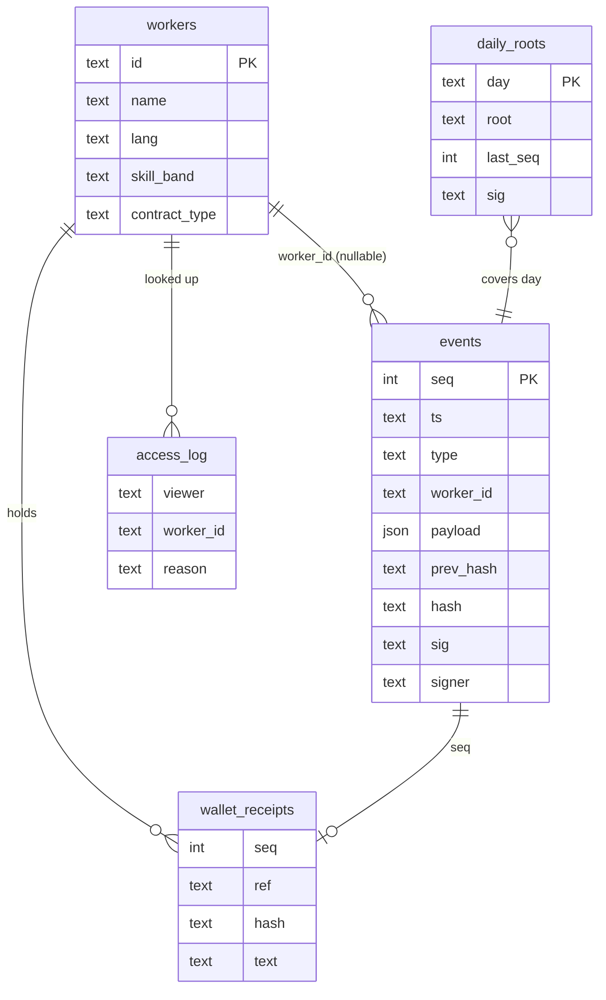

# Saakshi architecture

Saakshi turns every work event (a punch, an overtime consent, a production count, a camera
event) into a **signed, hash-chained record that the worker and the employer both hold**. Every
engine computes from that one record, so the worker app and the employer console cannot show two
versions of one shift.

## 1. System overview



## 2. Modules

| Module | File | Responsibility | Key events |
| --- | --- | --- | --- |
| Config / state | `config.py`, `state.py`, `db.py` | One SQLite connection, schema registry, key store | |
| Crypto | `crypto.py` | Canonical JSON, SHA-256, Merkle trees and proofs, Ed25519 key store | |
| Ledger | `ledger.py` | Append, read, `verify()`, daily roots, inclusion proofs, worker receipts | all |
| Core API | `core_api.py` | Workers, punches, corrections, receipts check, access log, demo tools | `punch.*`, `access.lookup` |
| Fair Pay | `pay.py` | Hours from punches, overtime cap and fatigue, signed consent, payslip, 9 fairness checks | `ot.*`, `pay.run`, `pf.deposit` |
| Voice | `voice.py`, `voice_client.py`, `web/shared/voice-client.js` | Blind-signature tokens, relay, nullifiers, threshold themes, "You said, we did" | `voice.report`, `voice.response` |
| Skill Passport | `passport.py`, `web/verify/` | Auto-issued W3C-VC-shaped credentials, QR, revocation, JD matching | `production.count`, `credential.*` |
| Edge | `edge.py`, `scripts/edge_sim.py` | Box-signed camera events, privacy guard, zone summaries | `edge.event` |
| Console | `console.py` | Exceptions ranked by legal risk, SDG 8 scorecard | (reads all) |
| i18n | `i18n.py`, `web/shared/i18n.js` | Receipts and UI in Tamil, Hindi, Odia, English | |

Every module exposes a FastAPI `router` and plain Python functions; the console imports those
functions, and each source is wrapped so one failing module never blanks the console. The full
HTTP contract is in [API.md](API.md).

## 3. The trust layer

Each event body is `{seq, site, ts, type, worker_id, payload, prev_hash}`.

```
hash = SHA-256(canonical_json(body))          canonical = sorted keys, no spaces, UTF-8
sig  = Ed25519(site_key, hash)
root(day) = Merkle(hash of every event that day)   leaf = H(0x00‖h), node = H(0x01‖l‖r)
```

`Ledger.verify()` recomputes everything from stored **content**, not stored hashes:

| Attack | What catches it |
| --- | --- |
| Edit a row (e.g. punch-out 19:41 → 18:00) | `content_edited`: content no longer matches the signed hash |
| Edit a row and recompute its hash | `bad_signature` (no private key) and `broken_link` (next event's `prev_hash`) |
| Delete a row | `missing_events` and `broken_link` |
| Rewrite a whole day consistently | `root_mismatch` against the root already published to workers, plus the worker's own receipts |

A correction is never an overwrite: `POST /api/punch/correction` appends a `punch.correction`
event with a reason and an approver, and the pay engine applies it.

### One shift and the live tamper test



## 4. Fair Pay

Deterministic arithmetic only; an LLM never computes money.

```
hourly   = (Basic + DA) / 26 / 8
OT pay   = 2 × hourly × OT hours
worked   = (out − in) − 1 h break if span > 5 h;   OT = max(0, worked − 8)
PF 12% of min(basic, 15,000) · ESI 0.75% if gross ≤ 21,000 · deductions ≤ 50% of wages
```

Overtime moves through signed steps: **request → cap check → worker consent (worker key) → hours
worked → payment**. A request that would breach the 144 h quarterly cap, or the fatigue limits
(>14 h OT in 7 days, or 6 straight OT days), is blocked and cannot be accepted. Fairness checks
on every pay run: ledger integrity, minimum wage, overtime paid right, deduction cap, PF deposits
vs deductions, equal pay within band, contract vs permanent, overtime spread (Gini), fatigue.
A payslip refuses to compute if any of the worker's events (or a published root) fails
verification.

## 5. Anonymous, verifiable voice

Blind RSA signatures (RFC 9474 style) with one issuer key per topic per month. This replaces
Semaphore from the design doc: same unlinkability for this use, no circuit downloads at demo time.

```mermaid
sequenceDiagram
  autonumber
  participant A as Worker app
  participant I as Issuer (knows who you are)
  participant R as Relay (third party)
  participant B as Theme board

  A->>A: m = random 32 bytes per topic, r = random
  A->>I: blinded = FDH(m)·rᵉ mod n  (all 10 topics at once)
  I->>I: check: current worker, one token per topic per month
  I-->>A: s' = blindedᵈ mod n
  A->>A: s = s'·r⁻¹ mod n  (valid signature on m; issuer never saw m)
  A->>R: {topic, m, s, text}  (no identity)
  R->>R: verify sᵉ = FDH(m); nullifier = H(month‖topic‖m); reject reuse
  R->>B: store text, time rounded to the hour, no worker id / IP
  B-->>B: publish theme only at ≥ 3 independent reports
```

The issuer sees only blinded values; for every pairing of issuance and redemption a valid
blinding factor exists, so it cannot link a report to a worker (`tests/test_voice.py` proves this
with the private key). Safety, heat and harassment escalate on the first report; harassment
points to the POSH Internal Committee, which needs a named complainant.

## 6. Skill passport and edge events

- **Passport.** `production.count` events feed a versioned rules table (e.g. overlock "U":
  ≥5 days at ≥70% efficiency and ≤2.5% defects). When met, a W3C-VC-shaped credential is signed
  with the site issuer key, stored, logged as `credential.issued`, and sent to the worker as a
  receipt. The QR carries the whole VC; `web/verify` checks it **offline** with tweetnacl against
  a cached issuer list. No floats in a VC, so Python and JS canonical JSON are byte-identical.
- **Edge.** The camera box signs each event; the server verifies the box key, then a recursive
  privacy guard rejects any key or value that looks like an image, face, video, embedding or
  person identity. Only zone, kind, count and time reach the ledger.

## 7. Data model



Module working tables (`ot_requests`, voice keys and reports, credentials) are caches; the
signed `events` table is the source of truth. Voice report rows have no worker column.

## 8. Security and privacy

- **Integrity:** signature per event, hash chain, published daily roots, worker-held receipts.
- **Browser:** strict CSP (`script-src 'self'`, no inline scripts), `X-Frame-Options: DENY`,
  `nosniff`, `no-referrer`, `no-store` on the API; server text is escaped before it reaches the DOM.
- **Input:** pydantic models with patterns and length limits; list and page sizes capped.
- **Visibility:** opening one worker's record requires a reason, is logged, and appears in that
  worker's app.
- **Demo tools** (`/api/demo/reset`, `/api/demo/tamper`) are disabled with `SAAKSHI_DEMO=0`.
- **Red lines, not built:** face recognition for discipline, emotion recognition, toilet-break
  tracking, keystroke logging, individual leaderboards, union-activity monitoring.
- **Demo shortcuts:** keys live in SQLite (production: HSM for the site, the phone for workers);
  the voice relay is run by our team; receipts sit in a wallet table standing in for WhatsApp.

## 9. Testing

| Suite | What it proves |
| --- | --- |
| `test_ledger.py` | naive edit, re-hash edit, payload edit, deletion and root mismatch are all caught; receipts expose the edit; corrections append; Merkle proofs |
| `test_pay.py` | 2× pricing, break rule, corrections, cap warning and block, consent signature, decline, fatigue, deduction cap, payslip held after a DB edit, seeded demo state |
| `test_voice.py` | blind-signature round trip, unlinkability, double-spend and re-issue refused, no identity stored, threshold, safety escalation, scrub, JS/Python hash match |
| `test_passport.py` | issued exactly at threshold, once; Python and Node signature checks; tamper fails; revocation; matching; QR |
| `test_edge.py` | box signature, privacy guard, unknown kinds, summaries |
| `scripts/demo.py` | the 7-step demo end to end with pass/fail checks |

CI (`.github/workflows/ci.yml`) runs ruff, pytest and the scripted demo.

## 10. Scaling path

`verify()` is a full scan, fine for a site-day of events. In production it becomes incremental:
verify from the last checkpointed root, and keep per-site chains so sites verify independently.
Daily roots can be anchored on a public chain when a buyer or regulator asks; personal data
never goes on-chain.
