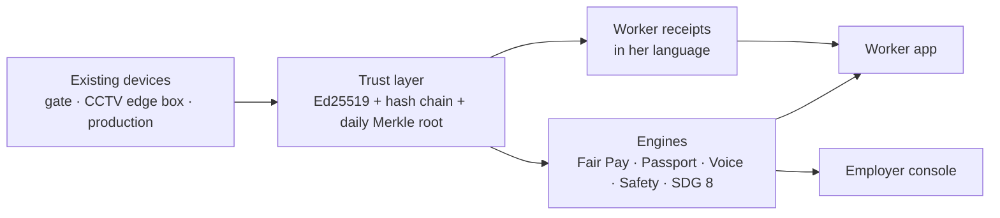

# PramaanOS · Saakshi (சாட்சி, "witness")

Shared, tamper-evident, privacy-preserving work records that **workers and employers both hold**.
Built for SDG 8 (decent work) in India's labour-intensive workplaces; the demo site is an export
garment unit in Tiruppur, Tamil Nadu.

> Rights without records are wishes. The labour codes in force since 21 Nov 2025 promise
> consent-based overtime at 2×, timely wages and grievance channels. What's missing is a record
> both sides trust. Saakshi signs every record where it is created and gives the worker a copy.

## Live Deployment (Vercel)

- **Live Landing**: [https://pramaanos.vercel.app](https://pramaanos.vercel.app)
- **Worker app (Meena, Tamil)**: [https://pramaanos.vercel.app/worker/?w=W001](https://pramaanos.vercel.app/worker/?w=W001)
- **Employer console**: [https://pramaanos.vercel.app/console/](https://pramaanos.vercel.app/console/)
- **Offline credential verifier**: [https://pramaanos.vercel.app/verify/](https://pramaanos.vercel.app/verify/)
- **API docs**: [https://pramaanos.vercel.app/docs](https://pramaanos.vercel.app/docs) · contract: [API.md](API.md)

## The problem, and how each part answers it

India's labour-intensive workplaces run on records only the employer holds. Among regular-wage
employees, 58% have no written contract and 53% no social security (PLFS 2023-24); 42% of
organised-factory workers are on contract (ASI 2023-24). Workers and employers complain about
opposite things, but the complaints share one root: **no record of work that both sides trust and
neither can quietly change.**

| Complaint (from the research dossier) | Root cause | Saakshi feature | Where you can see it |
| --- | --- | --- | --- |
| Wages late or short; PF deducted but not deposited | Pay computed in private spreadsheets | Deterministic pay from signed hours; payslip explained in her language; PF deposit vs deduction check | Demo step 2, Pay screen, `pay.py`, `test_pay.py` |
| Forced or unpaid overtime | No consent record, no cap at the point of rostering | Signed consent by the worker's key; 144 h/quarter cap and fatigue limits block the request before it happens | Demo step 2, `test_pay.py::test_cap_near_warning_and_blocking` |
| "Records prepared for the auditor" | Employer can rewrite history | Signed hash chain, daily Merkle root, worker-held receipts; payslip refuses edited records | Demo step 3 (live tamper), `test_ledger.py` |
| Fear of speaking up; retaliation | Grievances are identifiable | Blind-signature tokens, third-party relay, publish at 3 corroborating reports | Demo step 4, `test_voice.py::test_unlinkability` |
| Surveillance and "watched, judged, blocked" | Cameras record people | Edge events only; faces and images rejected; every look-up of a person's record needs a reason and is shown to them | Demo step 5, `test_edge.py`, access log in the worker app |
| No proof of skill; fake credentials; bias against groups | No portable, signed record of individual skill | Credential issued automatically from production data, verifiable offline by any employer | Demo step 6, `/verify/`, `test_passport.py` |
| Compliance load (69,233 compliances) | Rules applied after harm, in audits | Labour-code rules run as checks before the action; exceptions ranked by legal risk | Console overview, `console.py` |

**SDG 8 targets moved** (each tracked live on the console scorecard, `GET /api/sdg8/scorecard`):
8.2 productivity (line efficiency), 8.3 formalisation (workers holding their own signed record),
8.5 decent work and equal pay (minimum-wage and within-band gap checks), 8.6 skills (credentials
per worker-year), 8.7 forced labour (overtime with signed consent), 8.8 labour rights and safe work
(near-misses logged, anonymous reports answered).

## Engineering evidence

| Rubric area | Evidence |
| --- | --- |
| Problem statement alignment | The table above; [ARCHITECTURE.md](ARCHITECTURE.md) maps each module to a labour-code rule and SDG target |
| Security | [SECURITY.md](SECURITY.md) threat model; signed ledger; role-based API access; strict CSP; anonymous relay stores no identity |
| Efficiency | [docs/PERFORMANCE.md](docs/PERFORMANCE.md): cached and incremental verification, benchmark script `scripts/bench.py` |
| Testing | [docs/TESTING.md](docs/TESTING.md): unit, property-based tamper tests, API contract test, end-to-end demo test, coverage gate in CI |
| Accessibility | Four languages with read-aloud, axe-core WCAG 2.1 AA audit of both apps, keyboard navigation, status never by colour alone |
| Code quality | One module per engine behind a written [API contract](API.md); ruff lint clean; CI on every push |

## Run it locally

```bash
git clone https://github.com/TheOnlyOne001/PramaanOS && cd PramaanOS
pip install -r requirements.txt
uvicorn saakshi.app:app --port 8000        # seeds a week of signed history on first start
```

- Worker app (Meena, Tamil): http://localhost:8000/worker/?w=W001
- Employer console: http://localhost:8000/console/
- Offline credential verifier: http://localhost:8000/verify/
- API docs: http://localhost:8000/docs · contract: [API.md](API.md)

Tests and the scripted demo:

```bash
python3 -m pytest                       # 191 tests (93% coverage): ledger, pay, voice, passport, edge, security, perf, contract
python3 scripts/demo.py                 # the 3-minute demo, in-process, with pass/fail checks
python3 scripts/demo.py --base http://localhost:8000 --db data/saakshi.db --pause   # live, with both UIs open
python3 scripts/tamper.py               # the live tamper: edit Meena's punch-out straight in SQLite
python3 scripts/edge_sim.py --scenario press_zone   # the edge camera box
```

## The 3-minute demo

1. Meena punches in and gets a receipt in Tamil: `வருகை 08:02 · குறிப்பு 7F3A`.
2. Her supervisor asks for 2 h overtime. The console warns that two co-workers are near the
   144 h quarterly cap; Meena accepts by voice and her consent is signed with her key.
3. **Live tamper test.** Someone edits her punch-out in the database. The recomputed hash no longer
   matches the signature, the published daily root no longer matches, her own receipts disagree,
   and the payslip refuses to compute. Both dashboards flag it within seconds.
4. She reports anonymously that drinking water runs out by 3 pm. Two more reports corroborate it;
   the theme reaches the console with no identity attached.
5. A person steps into the press zone in front of the camera. An event appears; no video or face
   leaves the box (an event carrying a face crop is rejected).
6. Her quality data issues an "independent on overlock" credential; a recruiter verifies the QR
   offline against a cached issuer key.
7. Close on the SDG 8 scorecard.

## Screenshots

| Employer console after the tamper | Meena's app (Tamil) after the tamper |
| --- | --- |
|  |  |

More in [docs/screenshots](docs/screenshots).

## How it works

Full design, diagrams and threat model: **[ARCHITECTURE.md](ARCHITECTURE.md)**. HTTP contract: [API.md](API.md).



| Piece | File | What's real |
| --- | --- | --- |
| Signed ledger | `saakshi/ledger.py` | Ed25519 signature per event, SHA-256 hash chain, daily Merkle root with inclusion proofs. `verify()` catches content edits, re-hash attacks, deletions and root mismatches. Corrections are new signed events, never overwrites |
| Worker receipts | `saakshi/core_api.py`, `saakshi/i18n.py` | Every event naming a worker drops a receipt in their language; the worker's copy is checked against the employer's record |
| Access log | `saakshi/core_api.py` | Opening one worker's record needs a reason, and the worker sees who looked |
| Fair Pay | `saakshi/pay.py` | Deterministic pay from signed hours: OT at 2× of (Basic+DA)/26/8, 144 h/quarter cap, fatigue limits, signed consent, 50% deduction cap, PF/ESI, eight fairness checks, explanation in the worker's language |
| Voice | `saakshi/voice.py` | Blind RSA signature tokens (RFC 9474 style), one issuer key per topic per month, nullifier per topic, relay that stores no identity, publish at 3 corroborating reports, safety topics escalate at once |
| Skill passport | `saakshi/passport.py`, `web/verify/` | W3C-VC-shaped credential signed with Ed25519, issued automatically from production data, QR, offline browser verification, revocation list, JD matching |
| Edge events | `saakshi/edge.py`, `scripts/edge_sim.py` | Box-signed events; a privacy guard rejects any image, face, video or identity field |
| Console + SDG 8 | `saakshi/console.py` | Exceptions sorted by legal risk; scorecard for targets 8.2, 8.3, 8.5, 8.6, 8.7, 8.8 |

**Stubbed for the hackathon:** the biometric device (replayed punches), WhatsApp/SMS (receipts
are stored in a wallet table that stands in for the worker's phone), Bhashini (browser speech
APIs stand in), the Jetson vision pipeline (`edge_sim.py` emits the events it would), the voice
relay (run by our team and labelled as such), and all keys live in SQLite rather than an HSM or
the worker's phone.

**Change from the design doc:** anonymous voice uses blind-signature tokens instead of Semaphore.
Same unlinkability for this use, no large circuit files to download at demo time. The doc names
this as the fallback.

**Red lines (not built, on purpose):** face recognition for discipline, emotion recognition,
toilet-break tracking, keystroke logging, individual leaderboards, union-activity monitoring.

## Repository layout

```
saakshi/          FastAPI backend (one module per engine; see ARCHITECTURE.md)
web/worker/       worker app (mobile, 4 languages, read-aloud)
web/console/      employer console (exceptions first)
web/verify/       offline credential verifier
web/shared/       i18n strings, API helper, voice client, design tokens
tests/            pytest suites
scripts/          demo.py, tamper.py, edge_sim.py
```

## Caveats

- Wage tables, the 144 h cap and PF/ESI rates are illustrative Tamil Nadu values from secondary
  sources; state caps conflict across sources. Verify before any real use.
- The design rests on a research dossier whose labour-code details come from law-firm and payroll
  summaries (the government PDFs returned 403), and some citations are from memory.
