# PramaanOS · Saakshi (சாட்சி, "witness")

[](https://github.com/TheOnlyOne001/PramaanOS/actions/workflows/ci.yml)


**Shared, tamper-evident, privacy-preserving work records that workers and employers both hold.**
Every punch, overtime consent, production count and camera event is signed where it happens and
chained into a ledger. The worker gets a copy of each record in her own language, and nobody can
quietly rewrite one. Built for SDG 8 in India's labour-intensive workplaces. The demo site is an
export garment unit in Tiruppur, Tamil Nadu.

> Rights without records are wishes. The labour codes in force since 21 Nov 2025 promise
> consent-based overtime at 2×, timely wages and grievance channels. What's missing is a record
> both sides trust.

**Live:** [Landing](https://pramaanos.vercel.app) ·
[Worker app (Meena, Tamil)](https://pramaanos.vercel.app/worker/?w=W001) ·
[Employer console](https://pramaanos.vercel.app/console/) ·
[Offline verifier](https://pramaanos.vercel.app/verify/) ·
[API docs](https://pramaanos.vercel.app/docs)

| Employer console: the moment a record is edited | Meena's app: her receipt proves it |
| --- | --- |
| 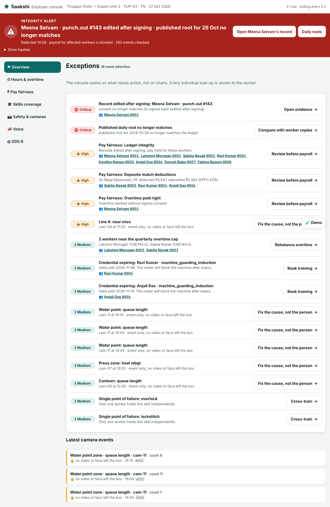 | 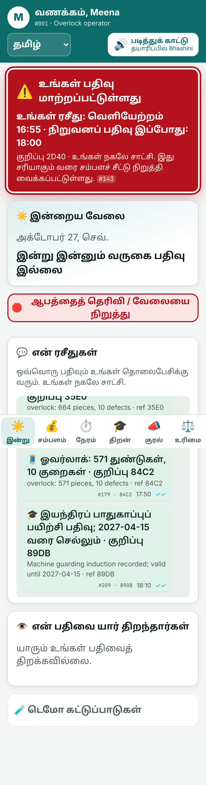 |

---

## Contents

[Problem](#the-problem) · [Features](#features) · [Architecture](#architecture) ·
[Quick start](#quick-start) · [Demo](#the-3-minute-demo) · [Quality](#engineering-quality) ·
[Configuration](#configuration) · [Layout](#repository-layout) · [Limitations](#limitations-and-roadmap) · [Docs](#documentation)

## The problem

India's labour-intensive workplaces run on records that only the employer holds. Among
regular-wage employees, 58% have no written contract and 53% no social security (PLFS 2023-24).
42% of organised-factory workers are on contract (ASI 2023-24). Workers and employers complain
about opposite things, and the complaints share one root: **no record of work that both sides
trust and neither can quietly change.**

| Complaint (from the research dossier) | Root cause | Saakshi's answer | Proof |
| --- | --- | --- | --- |
| Wages late or short; PF deducted but not deposited | Pay computed in private spreadsheets | Deterministic pay from signed hours, explained in her language; PF deposited vs deducted per contractor | Demo step 2 · `test_pay.py` |
| Forced or unpaid overtime | No consent record, no cap when rostering | Consent signed by the worker's key; 144 h/quarter cap and fatigue limits block the request up front | Demo step 2 · `test_pay.py` |
| "Records prepared for the auditor" | The employer can rewrite history | Signed hash chain, published daily Merkle root, worker-held receipts; payslip refuses edited records | Demo step 3 · `test_ledger*.py` |
| Fear of speaking up | Grievances are identifiable | Blind-signature tokens, an anonymous relay, publication only at 3 corroborating reports | Demo step 4 · `test_voice.py` |
| Being watched, judged, blocked | Cameras record people; look-ups are invisible | Camera events only, faces and images rejected; every look-up needs a reason and is shown to the worker | Demo step 5 · `test_edge.py` |
| No proof of skill; bias against groups | No portable record of individual skill | Credential issued automatically from production data, verifiable offline by any employer | Demo step 6 · `test_passport.py` |
| Employers drowning in compliance | Rules applied after harm, in audits | Labour-code rules run as checks before the action; exceptions ranked by legal risk | Console · `test_console.py` |

## Features

**Trust layer (`ledger.py`).** Ed25519 signature on every event, a SHA-256 hash chain, and a daily
Merkle root with inclusion proofs. `verify()` recomputes from stored content and catches content
edits, re-hash attacks, deletions and published-root mismatches. Corrections are new signed events
with a reason and an approver, never overwrites.

**Worker receipts (`core_api.py`, `i18n.py`).** Each event naming a worker drops a receipt in
Tamil, Hindi, Odia or English (`வருகை 08:02 · குறிப்பு 7F3A`). The worker's copy is checked against
the employer's record, so a silent edit shows up on her phone.

**Fair Pay (`pay.py`).** Deterministic arithmetic, never an LLM: overtime at 2 × (Basic+DA)/26/8,
a 144 h quarterly cap with a near-cap warning, fatigue limits, consent signed with the worker's
key, PF and ESI, and a 50% deduction cap. Nine fairness checks run on every pay run: ledger
integrity, minimum wage, overtime paid right, deduction cap, PF deposits vs deductions, equal pay
within band, contract vs permanent, overtime spread (Gini) and fatigue. The payslip is explained
in the worker's language and is held if any of her records fails verification.

**Anonymous voice (`voice.py`).** Blind RSA signatures (RFC 9474 style) with one issuer key per
topic per month and a nullifier per topic, so each worker speaks once per topic and the issuer
cannot link a report to a person. A relay stores no identity, IP or exact time. A theme reaches
management at 3 independent reports. Safety, heat and harassment escalate at once, and harassment
points to the POSH Internal Committee. Management answers on a "You said, we did" board.

**Skill passport (`passport.py`, `web/verify/`).** Production counts feed a versioned rules table.
When a worker meets it, a W3C-VC-shaped credential is signed and sent to her. The QR carries the
whole credential, which any employer can verify offline in the browser. Includes a revocation
list, expiring safety inductions and job-description matching.

**Edge safety (`edge.py`).** The camera box signs each event. A recursive privacy guard rejects
anything that looks like an image, face, video, embedding or person identity, so only zone, kind,
count and time leave the site.

**Access control (`auth.py`).** Signed bearer tokens with worker, supervisor, HR and auditor roles,
enforced by one deny-by-default policy table. Workers read only their own pay and receipts and
accept only their own overtime. Opening one worker's record needs a reason, which she sees.

**Two front-ends (`web/`), plain JS with no build step.**
- **Worker app:** Today, Pay, Hours, Skills, Voice and Rights screens; voice-first with read-aloud
  and dictation; large touch targets; a WhatsApp-style receipt feed; an integrity banner.
- **Employer console:** opens on exceptions, not charts; sections for Hours & overtime, Pay
  fairness, Skills coverage, Safety & cameras, Voice and SDG 8; every number links to its signed
  evidence and Merkle proof.

**SDG 8 scorecard (`console.py`).** Live indicators for targets 8.2 (line efficiency), 8.3
(workers holding their own signed record), 8.5 (minimum wage and equal pay), 8.6 (credentials per
worker-year), 8.7 (overtime with signed consent) and 8.8 (near-misses logged, reports answered).

<details>
<summary>More screenshots</summary>

| | |
| --- | --- |
| 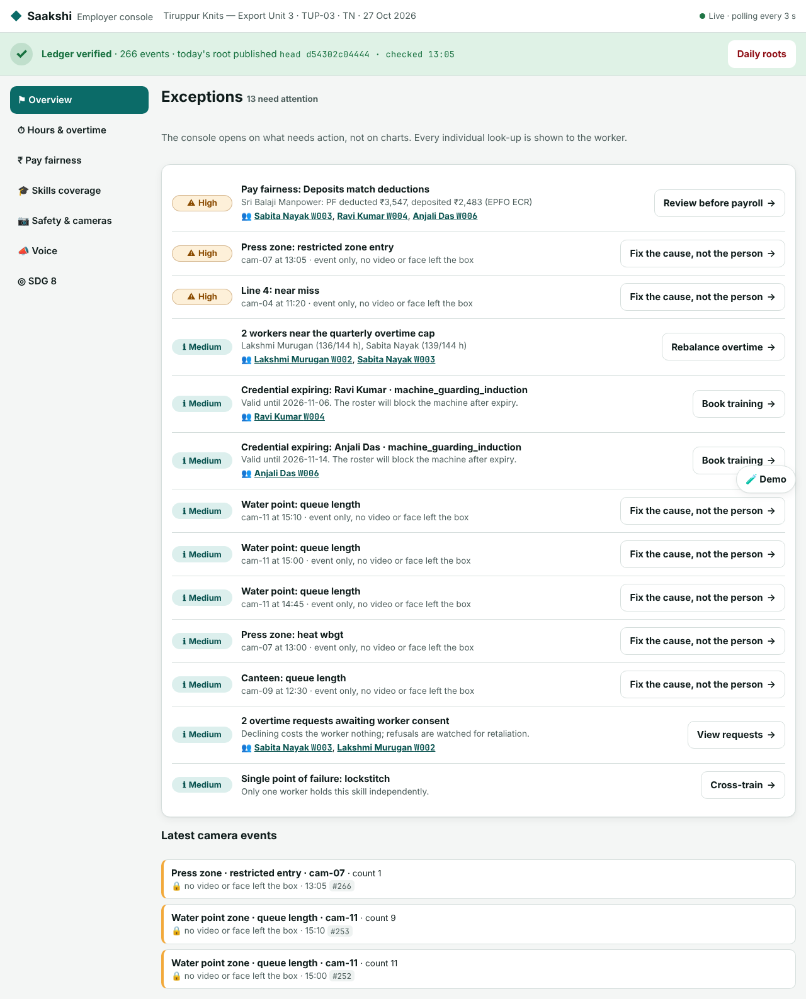 Console overview | 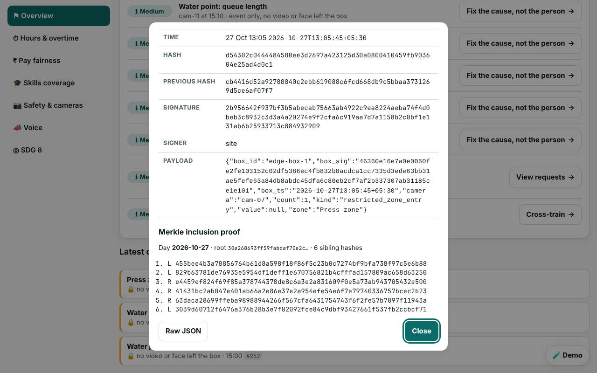 Evidence with Merkle proof |
| 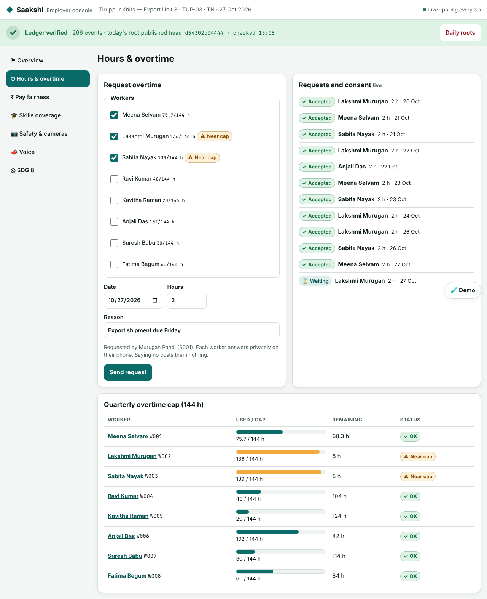 Overtime and caps | 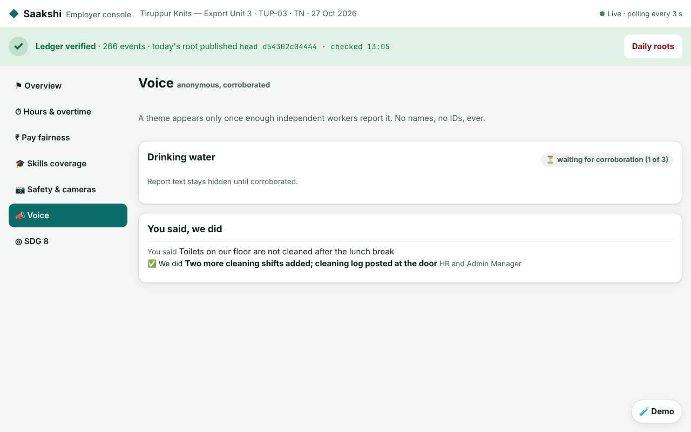 Anonymous voice themes |
| 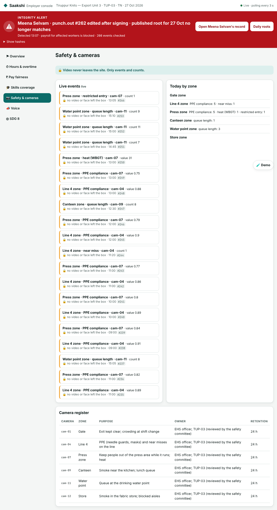 Camera events, no video | 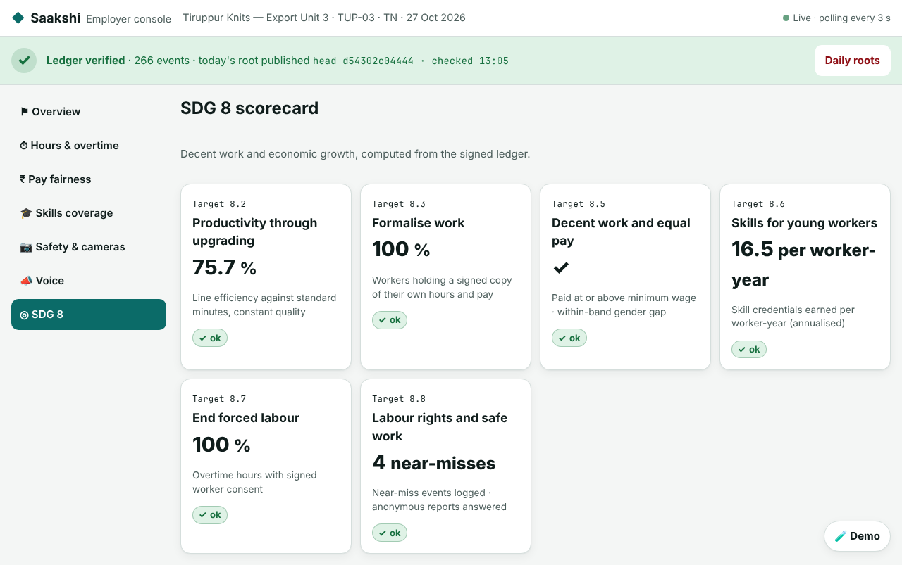 SDG 8 scorecard |
| 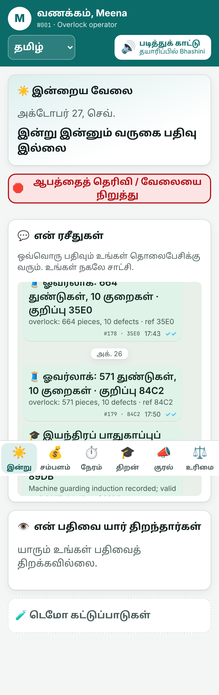 Worker: Today | 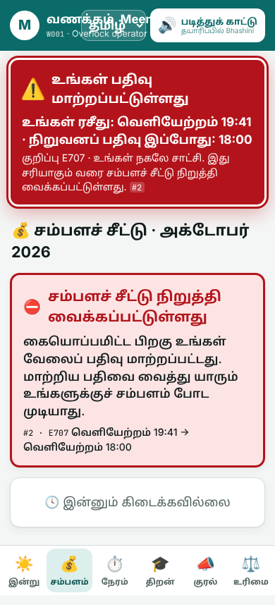 Worker: payslip |
| 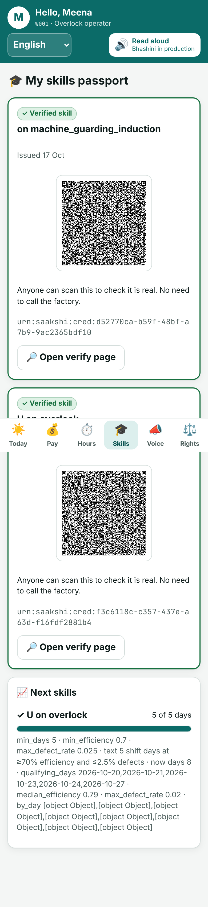 Worker: skill passport | 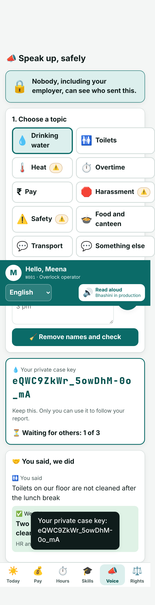 Worker: speak anonymously |

</details>

## Architecture

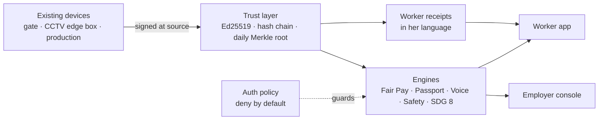

One signed record feeds every engine, so the worker app and the console cannot show two versions
of one shift. The full design is in **[ARCHITECTURE.md](ARCHITECTURE.md)**: sequence diagrams for a
shift with the live tamper test and for the anonymous voice protocol, the data model, labour-code
rules mapped to the functions that enforce them, and the threat model.

## Quick start

Requires Python 3.11+ (Node 22 only for the JS-compatibility tests).

```bash
git clone https://github.com/TheOnlyOne001/PramaanOS && cd PramaanOS
pip install -r requirements.txt
uvicorn saakshi.app:app --port 8000      # seeds a week of signed history on first start
```

Open http://localhost:8000/worker/?w=W001 (Meena) and http://localhost:8000/console/ side by side.
In demo mode each app signs itself in with the right role. To call the API directly:

```bash
TOKEN=$(curl -s -XPOST localhost:8000/api/auth/demo-login -H 'content-type: application/json' \
        -d '{"role":"supervisor"}' | python3 -c 'import sys,json;print(json.load(sys.stdin)["token"])')
curl -s localhost:8000/api/ledger/verify -H "Authorization: Bearer $TOKEN"
```

## The 3-minute demo

```bash
python3 scripts/demo.py                                    # in-process, with pass/fail checks
python3 scripts/demo.py --base http://localhost:8000 --db data/saakshi.db --pause   # live on both screens
```

1. **Punch in.** Meena punches in and gets a receipt in Tamil.
2. **Overtime.** Her supervisor asks for 2 h. The console warns that two co-workers are near the
   144 h cap. Meena accepts by voice, and her consent is signed with her key.
3. **Live tamper test.** Her punch-out is edited straight in SQLite (`scripts/tamper.py`). The hash
   no longer matches the signature, the published root no longer matches, her receipt disagrees,
   and her payslip is held. Both apps flag it within seconds.
4. **Anonymous report.** She reports that drinking water runs out by 3 pm. Two more reports
   corroborate it, and the theme reaches the console with no identity attached.
5. **Camera event.** A person steps into the press zone (`scripts/edge_sim.py`). An event appears,
   and an event carrying a face crop is rejected.
6. **Skill credential.** Her quality data issues "independent on overlock", and a recruiter
   verifies the QR offline.
7. **SDG 8 scorecard.**

## Engineering quality

| Area | What we did | Evidence |
| --- | --- | --- |
| **Security** | Signed ledger; deny-by-default role policy; strict CSP and security headers; validated inputs; anonymous relay strips identity; demo tools switch off in production | [SECURITY.md](SECURITY.md) · `test_security.py` |
| **Testing** | 191 tests, 93% coverage: property-based tamper tests (any single-row edit is caught), API contract test, security policy, cache invalidation, all four languages complete, the full demo as an end-to-end test; CI gate on coverage | [docs/TESTING.md](docs/TESTING.md) |
| **Efficiency** | Verification cached on a write fingerprint that any edit moves, and only new events re-checked; pay and console memoised. On 20k events: console overview 19.8 s → 5.7 ms, payslip 1.2 s → 0.9 ms (cache hits; first view after a write ≈ 1.2 s) | [docs/PERFORMANCE.md](docs/PERFORMANCE.md) · `scripts/bench.py` |
| **Accessibility** | 0 axe-core WCAG 2.1 AA violations on audited pages; skip links; dialog focus management; 44 px targets; status shown by icon and word, never colour alone; reduced motion; four languages with read-aloud | Screenshots · `web/` |
| **Code quality** | One module per engine behind a written [API contract](API.md); ruff lint clean; CI runs lint, tests and the demo on every push | `.github/workflows/ci.yml` |

**Red lines, not built on purpose:** face recognition for discipline, emotion recognition,
toilet-break tracking, keystroke logging, individual leaderboards, union-activity monitoring.

## Configuration

| Variable | Default | Purpose |
| --- | --- | --- |
| `SAAKSHI_DB` | `data/saakshi.db` (`/tmp` on Vercel) | SQLite path |
| `SAAKSHI_AUTOSEED` | `1` | Seed demo history on first start |
| `SAAKSHI_DEMO` | `1` | Demo login, reset and tamper endpoints. **Set `0` in production** |
| `SAAKSHI_AUTH` | `1` | Enforce the access-control policy |
| `SAAKSHI_AUTH_SECRET` | unset | Shared token secret; required on serverless hosts with several instances |

Deploying to Vercel uses `vercel.json` and `api/index.py`. See [SECURITY.md](SECURITY.md) for the
serverless notes.

## Repository layout

```
saakshi/        FastAPI backend: ledger, auth, pay, voice, passport, edge, console, i18n
web/worker/     worker app (mobile, 4 languages, read-aloud)
web/console/    employer console (exceptions first)
web/verify/     offline credential verifier
web/shared/     i18n strings, API helper, voice client, design tokens
tests/          191 pytest tests (unit, property-based, contract, security, perf, e2e)
scripts/        demo.py · tamper.py · edge_sim.py · bench.py
docs/           PERFORMANCE.md · TESTING.md · screenshots/
```

## Limitations and roadmap

**Stubbed for the hackathon:**
- **Inputs:** the biometric device is replaced by replayed punches. The Jetson vision pipeline is
  replaced by `edge_sim.py`, which emits the same events.
- **Messaging and speech:** WhatsApp/SMS is replaced by a wallet table that stands in for the
  worker's phone. Bhashini is replaced by browser speech APIs.
- **Trust infrastructure:** the voice relay is run by our team and labelled as such. Keys live in
  SQLite, where production would use an HSM for the site and the phone for workers.
- **Serverless data:** on Vercel, each instance keeps its own demo data.

**Change from the design doc:** anonymous voice uses blind-signature tokens instead of Semaphore.
It gives the same unlinkability here, without large circuit downloads at demo time; the doc names
it as the fallback.

**Caveats:** wage tables, the 144 h cap and PF/ESI rates are illustrative Tamil Nadu values from
secondary sources, and state caps conflict across sources, so verify before real use. Labour-code
details come from law-firm and payroll summaries because the government PDFs were unreachable.

**Next:**
- Phone OTP sign-in.
- One shared Postgres with an append-only role.
- Per-site chains with signed checkpoints.
- Public anchoring of daily roots.
- More states' rule tables.

## Documentation

| Doc | Contents |
| --- | --- |
| [ARCHITECTURE.md](ARCHITECTURE.md) | Design, diagrams, labour-code mapping, data model, scaling |
| [API.md](API.md) | HTTP contract for every endpoint |
| [SECURITY.md](SECURITY.md) | Roles, threat model, production deployment |
| [docs/TESTING.md](docs/TESTING.md) | Test strategy, coverage per module |
| [docs/PERFORMANCE.md](docs/PERFORMANCE.md) | Benchmarks and why the cache cannot hide a tamper |
